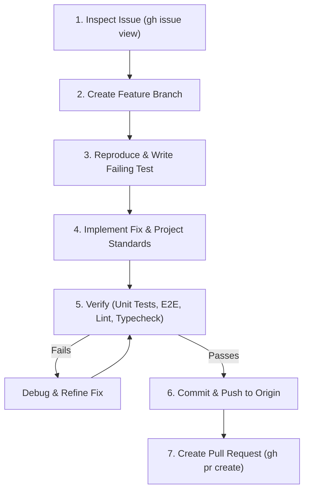

# GitHub Issue Resolution Workflow

This skill guides an agent through the complete lifecycle of fixing an issue reported in GitHub: from initial issue inspection and automated reproduction, to implementing the fix according to codebase standards, running verification tests, debugging, and submitting a pull request.

---

## Workflow Steps



> [!IMPORTANT]
> **Do NOT Merge into `main`:**
> The agent's workflow terminates after creating the Pull Request. **Never merge the PR or push directly to `main`** (do not run `gh pr merge`, `git merge`, or `git push origin main`). The user / repository maintainer is solely responsible for reviewing and merging the result.

---

### Step 1: Issue Inspection & Context Gathering

1. Fetch the issue details and discussion using GitHub CLI:
   ```bash
   gh issue view <issue_number> --json number,title,body,comments,labels
   ```
2. Identify:
   - The reported bug, broken user flow, or feature request.
   - Any stack traces, error messages, or affected URL routes.
   - Expected vs. actual behavior.
   - Any related RFC proposals in `docs/rfcs/` or contributor guidelines in `AGENTS.md`.

---

### Step 2: Create a Clean Feature Branch

1. Ensure the working directory is clean and up to date with the default branch:
   ```bash
   git checkout main
   git pull origin main
   ```
2. Create and switch to a descriptive branch named after the issue:
   ```bash
   git checkout -b fix/issue-<issue_number>-<short-description>
   ```
   *(For feature requests or enhancements, use `feat/issue-<issue_number>-<short-description>`)*.

---

### Step 3: Reproduce the Issue with a Test

Before writing the fix, create a test case that captures the reported defect:

1. **Unit / Service Issue:**
   - Add a test case to the corresponding co-located unit test (e.g. `src/services/<service>.test.ts` or `src/widgets/<widget>.test.ts`).
2. **Visual / End-to-End Workflow Issue:**
   - Add a test scenario to Playwright E2E tests (`test/e2e/`) using the reusable mock harness (`test/e2e/fixtures/mock-yoto.ts`).
3. Run the targeted test to confirm that it reliably reproduces the failure:
   ```bash
   npm run test:unit
   # or
   npx playwright test test/e2e/<test-file>.spec.ts
   ```

---

### Step 4: Develop the Fix

Implement the necessary changes while strictly adhering to the architectural rules in [`AGENTS.md`](file:///home/anitschk/sandbox/yoto-bench/AGENTS.md):

1. **Widget Library First Policy:**
   - Check `src/widgets/AGENTS.md` before writing any UI elements. Reuse existing `<yb-*>` primitives.
   - Never write ad-hoc HTML/CSS for common UI controls.
2. **Strict TypeScript & Type Safety:**
   - Never use `any`. Wrap untyped external inputs in safe Zod or TypeScript abstractions.
   - Enforce strict null checks and explicit return types.
3. **Reactive State via Lit Context (`@lit/context`):**
   - Treat context values as immutable (always assign fresh object copies so subscribers re-render).
4. **Unified API Client Pipeline:**
   - All Yoto REST requests must flow through `YotoApiClient` in `src/api/client.ts`. Never use raw ad-hoc `fetch()` calls to Yoto APIs.
5. **Code Comments & RFC References:**
   - Explain the "Why", not the "What".
   - Reference the relevant RFC number (`See: docs/rfcs/NNN-...`) when applying architectural policies.

---

### Step 5: Debug & Verify

Run the complete verification pipeline locally:

```bash
# 1. Typecheck & Static Analysis
npm run typecheck
npm run lint

# 2. Co-located Unit / Component Tests
npm run test:unit

# 3. End-to-End Browser Tests
npm run build
npm run test:e2e
```

#### If Tests Fail (Debugging Protocol):
1. Review the failure log or Playwright `error-context.md` in `test-results/`.
2. Check browser console logs and 404 network requests reported by the test runner.
3. Isolate whether the failure is due to:
   - Async timing / race conditions (ensure awaiting `el.updateComplete` or using Playwright web-first assertions).
   - Route mismatches or unhandled edge cases in mocks.
   - Missing CSP allowances or CORS proxy handling.
4. Iterate on the fix until all tests pass without errors or warnings.

---

### Step 6: Commit and Push

1. Inspect the exact diff before committing:
   ```bash
   git status
   git diff
   ```
2. Stage only relevant source, test, and documentation files (do not stage scratch files or build artifacts in `dist/`).
3. Commit with a conventional commit message referencing the issue:
   ```bash
   git commit -m "fix(<scope>): <short description> (fixes #<issue_number>)"
   ```
4. Push the branch to the remote repository:
   ```bash
   git push -u origin fix/issue-<issue_number>-<short-description>
   ```

---

### Step 7: Create the Pull Request

Submit the pull request using GitHub CLI:

```bash
gh pr create \
  --title "fix(<scope>): <concise summary>" \
  --body "## Summary
Brief explanation of the root cause and the fix applied.

Fixes #<issue_number>

## Changes Made
- Point 1
- Point 2

## Verification
- [x] npm run typecheck
- [x] npm run lint
- [x] npm run test:unit (all unit tests passing)
- [x] npm run test:e2e (all Playwright tests passing)"
```

Confirm the PR link generated by GitHub CLI and report the result to the user.

> [!WARNING]
> **Do Not Merge:** Stop immediately once the PR is created. Do NOT execute `gh pr merge`, do NOT merge the branch into `main` locally, and do NOT push commits to `main`. The user is responsible for reviewing and merging the pull request.
