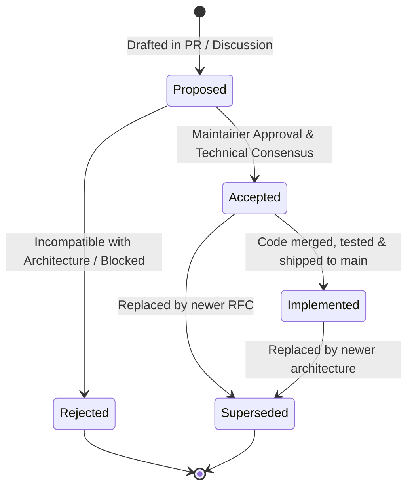

# RFC Management Guidelines & Lifecycle Policy (`docs/rfcs/AGENTS.md`)

Welcome to `docs/rfcs/`! This directory contains the Requests for Comments (RFCs) that serve as the Architectural Decision Records (ADRs), technical specifications, and implementation blueprints for `yoto-bench` (YotoBench).

Every major subsystem, integration, protocol, and architectural convention must have a corresponding RFC documented here.

---

## 1. RFC Lifecycle & Status Tracking

Every RFC transitions through a well-defined lifecycle. Contributors and AI agents must keep RFC metadata accurate:



### Status Definitions:
1. **`Proposed`**: Initial design draft. The RFC is actively undergoing review, technical feasibility checks, and architecture discussion.
2. **`Accepted`**: The architectural design, security boundaries, and tradeoffs are agreed upon by maintainers and ready for active implementation.
3. **`Implemented`** *(MANDATORY STATUS TRANSITION)*:
   - **Once an RFC's implementation is completed, verified with unit/E2E tests, and merged into the `main` branch, the author or completing agent MUST update the RFC's status line from `Accepted` (or `Proposed`) to `Implemented`.**
   - Optionally record the completion date, merged pull request, or commit hash in the metadata header.
4. **`Rejected`**: Evaluated but discarded due to technical constraints, external roadblocks, or misalignment with our static/serverless principles. The RFC must document why it was rejected in the alternatives/outcomes section.
5. **`Superseded`**: Replaced or fundamentally redesigned by a subsequent RFC. Must include a clear reference link to the new RFC (e.g. `Superseded by [RFC 025](025-new-approach.md)`).

---

## 2. File Naming & Numbering Convention

1. **Location:** All RFCs live directly in `docs/rfcs/`.
2. **File Naming Pattern:** `NNN-short-kebab-slug.md`
   - `NNN`: Strictly sequential, zero-padded 3-digit integer (e.g. `001-`, `008-`, `023-`).
   - `short-kebab-slug`: Descriptive, lowercase, hyphen-separated noun phrase (e.g. `podcast-rss-importer-and-card-sync.md`).
3. **Number Allocation:** Always check the directory for the highest existing number before authoring a new RFC. Do not reuse or duplicate RFC numbers.

---

## 3. Standard RFC Document Format

Every new RFC must adhere to this Markdown structure:

```markdown
# RFC NNN: Title of the Proposal

- **Date:** YYYY-MM-DD
- **Status:** Proposed | Accepted | Implemented | Rejected | Superseded
- **Author:** Contributor Name or AI Agent
- **Area:** Architecture | UI / Widgets | Audio & OPFS | Icons | Security & Auth | DevOps
- **Related RFCs:**
  - [RFC XXX: Title](file:///home/anitschk/sandbox/yoto-bench/docs/rfcs/XXX-title.md)

---

## 1. Summary
A concise 1–3 paragraph executive summary explaining what is being proposed, why it is needed, and the primary technical approach.

---

## 2. Motivation & Problem Statement
Explain the existing limitations, user pain points, or architectural debt that this proposal resolves. Detail the goals and non-goals.

---

## 3. Detailed Design & Architecture
The technical blueprint of the solution:
- Component contracts, module structures, and public TypeScript interfaces.
- Data flows and sequence diagrams (using Mermaid).
- State management integration (`@lit/context`, `@lit-labs/router`).
- REST endpoints and external protocol interactions.

---

## 4. Security, Privacy, & Storage Implications
Evaluate against our core principles (AGENTS.md):
- Static & Serverless: Does it require any backend server? (Strictly client-side only).
- Storage tiers: Local storage for metadata vs. OPFS for large/ephemeral binaries.
- Content Security Policy (CSP) & Subresource Integrity (SRI) impacts.
- Telemetry & GDPR: Does this collect any new metrics? (Must disclose on `/privacy`).

---

## 5. Testing & Verification Plan
Specify how this change will be verified:
- Co-located unit tests run with `@web/test-runner` (`npm run test:unit`).
- End-to-end integration flows run with Playwright (`npm run test:e2e`).
- Devtools sandbox verification (`/devtools/widgets`).

---

## 6. Alternatives Considered & Rejected Options
Document alternative architectures, libraries, or approaches that were considered and explain why they were rejected.
```

---

## 4. Rules for Contributors & Agents

1. **Update Status Upon Merging:** Whenever you finish implementing the features described in an RFC, update `- **Status:** Implemented` in that RFC as part of your PR or in a follow-up commit.
2. **Cite RFCs in Source Code & Configurations:** In accordance with `AGENTS.md` Rule 7, code comments, configuration files (e.g. `netlify.toml`, `vite.config.ts`), and commit messages should cite the relevant RFC number when implementing a policy or design pattern defined in that RFC.
3. **Update `README.md` & `ARCHITECTURE.md`:** When an RFC transitions to `Implemented`, verify that high-level overviews in `README.md` (e.g. features list) and `docs/ARCHITECTURE.md` reflect the newly shipped capabilities.
